# 小欧屏 (XiaoOuScreen)

> **车载超宽副屏 (1920×384) 气象动态背景、常驻挡位HUD、车载原生歌词引擎与车机设置中心**

[-brightgreen.svg)](https://developer.android.com)
[]()
[]()
[](LICENSE)

---

## 📖 项目简介

**小欧屏 (XiaoOuScreen)** 是一套专为车载超宽副屏（1920×384 黄金比例）深度定制研发的综合车载应用。针对车机芯片（如联发科 MT6771 / Mali-G72 等）在性能与能耗上的严苛要求，全工程基于 **Native Canvas 零 GC 内存复用机制** 与 **Jetpack Compose 现代化架构** 构建，兼具极致流畅与低能耗。

### 🌟 核心功能特性

1. **气象动态背景与大气融合时钟**：
   - **双天气源智能融合**：支持和风天气 (QWeather) 与 Open-Meteo 实时气象数据，自动计算日出日落（精准判定拂晓与落日）。
   - **自适应光照与粒子系统**：支持 **4 大昼夜时段 × 7 种天气 = 28 种拟真全景** 动态光照、雨滴、雪花、雾气及电闪雷暴粒子渲染。
   - **零 GC 高性能渲染**：在 `onDraw` 循环中彻底规避对象分配，粒子采用对象池循环复用，画面切换支持平滑 Cross-Fade 渐变过渡。

2. **车载原生歌词引擎与音乐岛**：
   - **原生卡拉OK逐字高亮**：支持毫秒级逐字精准染色动效。
   - **多通道音源智能仲裁**：集成媒体通知监听、MediaSession 协议拦截、广播侦听及酷狗车载原生客户端通信，自适应匹配音源与专辑封面取色。
   - **JS 外置歌词源引擎**：内置基于 Rhino 的轻量 JS 插件引擎，支持动态导入/扩展在线歌词检索源。
   - **全屏歌词与胶囊微缩**：支持超宽副屏全屏大字沉浸模式与顶部胶囊音乐岛快速视窗。

3. **原生 3D 挡位与驾驶模式动效**：
   - **挡位立方体翻转 (P/R/N/D)**：基于原生 Canvas 矩阵三维变换模拟立方体垂直滚动翻转。
   - **驾驶模式斜切横向滑动 (ECO / NORMAL / SPORT / RACE)**：带斜切视差与渐变遮罩的动效切换。
   - **常驻挡位 HUD**：副屏左下方小巧常驻挡位指示，安全不遮挡核心内容。

4. **车载通话状态机**：
   - 监听车载电话呼入、通话中与挂断事件，自动触发呼叫波纹动效与手机号码脱敏展示。

5. **新拟物风格设置中心 (Jetpack Compose)**：
   - 针对车载触控优化的 Neu-morphism（新拟物凹凸质感）控制面板。
   - 支持天气源切换、API Key 配置、全屏歌词排版调节、开机自启托管、源管理及关于信息。

---

## 🎨 昼夜时段 × 气象状态 28 种拟真全景效果展示

小欧屏内置由物理光学算法驱动的真实大气天色系统，根据 GPS 定位计算太阳高度角与日出日落时刻，在 **晨曦 (Dawn)**、**白昼 (Day)**、**黄昏 (Dusk)** 与 **夜晚 (Night)** 4 大时段，以及 7 种核心天气（晴朗、多云、阴雾、雨天、雪天、雷暴、雨夹雪）之间智能平滑渐变：

### 🌟 四大时段核心视觉对照

| 时段 | 效果预览 (1920 × 384 超宽实车副屏渲染) |
|---|---|
| **白昼 (Day)** | 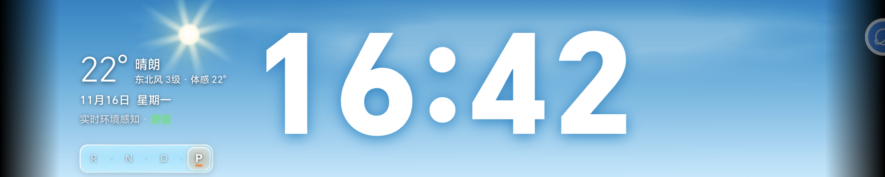 |
| **黄昏 (Dusk)** | 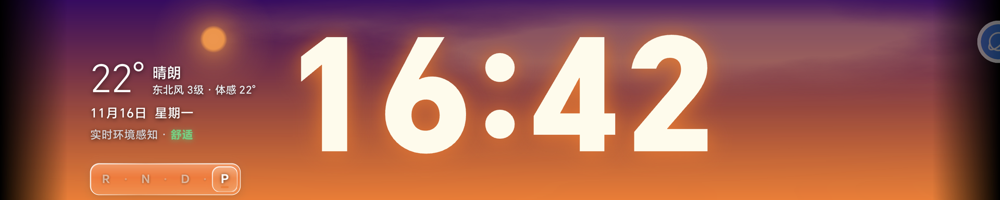 |
| **夜晚 (Night)** | 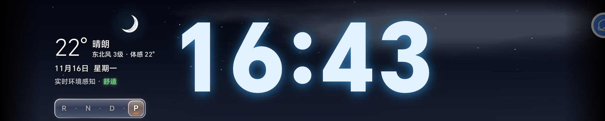 |
| **晨曦 (Dawn)** | 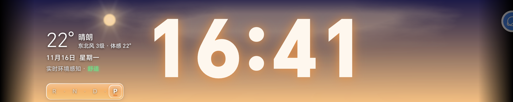 |

---

### ☀️ 一、白昼时段 (Day) · 蔚蓝晴空与强明度散射

> 正午阳光充足，天空呈高明度深天青渐变，时钟与信息 HUD 采用高对比度纯白与天青光晕。

| 气象状态 | 效果截图 |
|---|---|
| **晴朗 (Clear)** |  |
| **多云 (Cloudy)** | 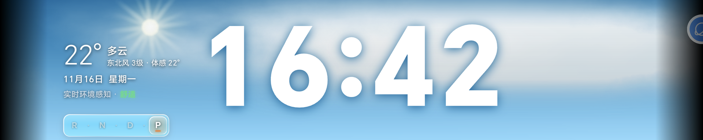 |
| **阴天/雾 (Overcast)** | 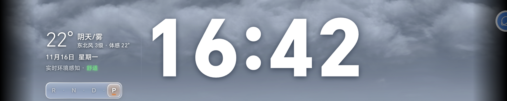 |
| **雨天 (Rain)** | 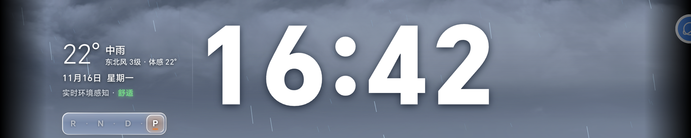 |
| **雪天 (Snow)** | 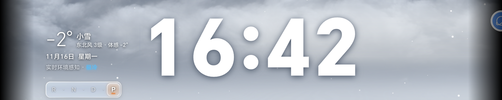 |
| **雷暴 (Storm)** | 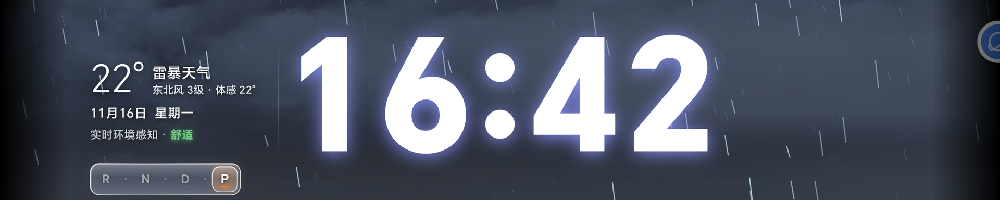 |
| **雨夹雪 (Sleet)** | 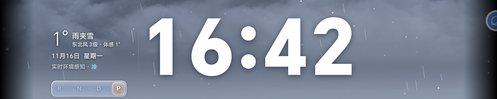 |

---

### 🌇 二、黄昏时段 (Dusk) · 赤金夕阳与晚霞云海

> 日落前后 45 分钟，西方地平线呈现赤金到暗紫红的火烧云漫射，时钟文字散发落日炽金色漫反射光晕。

| 气象状态 | 效果截图 |
|---|---|
| **晴朗 (Clear)** |  |
| **多云 (Cloudy)** | 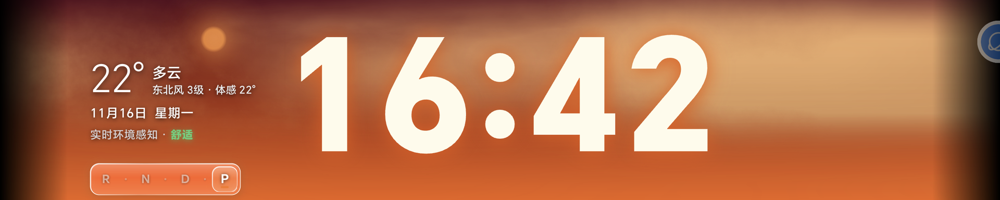 |
| **阴天/雾 (Overcast)** | 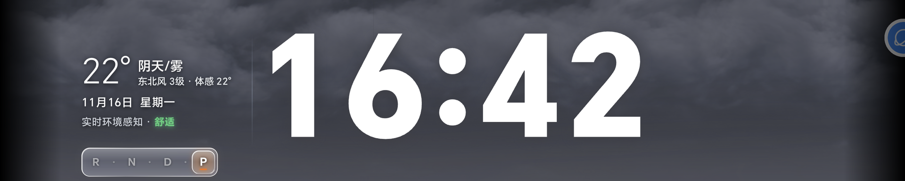 |
| **雨天 (Rain)** | 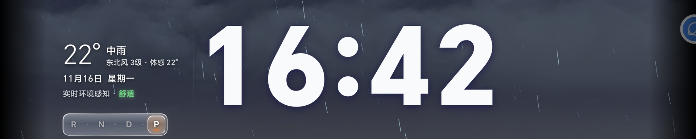 |
| **雪天 (Snow)** | 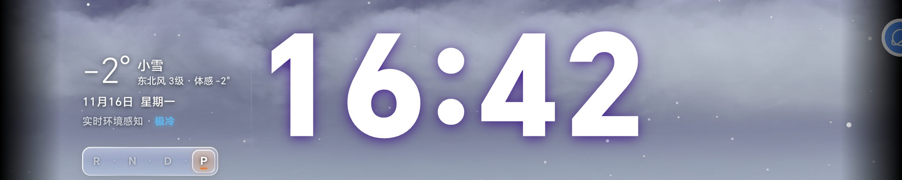 |
| **雷暴 (Storm)** | 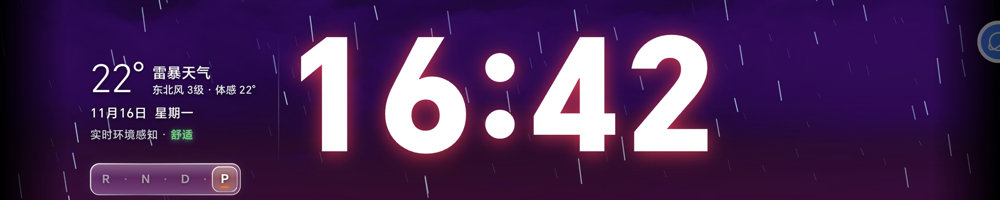 |
| **雨夹雪 (Sleet)** | 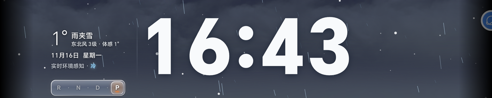 |

---

### 🌙 三、夜晚时段 (Night) · 静谧月夜与深空电弧

> 极夜深空背景，暗调黑蓝与深空紫渐变，月亮自适应月相、星云粒子微闪，夜间驾车不刺眼。

| 气象状态 | 效果截图 |
|---|---|
| **晴朗 (Clear)** |  |
| **多云 (Cloudy)** | 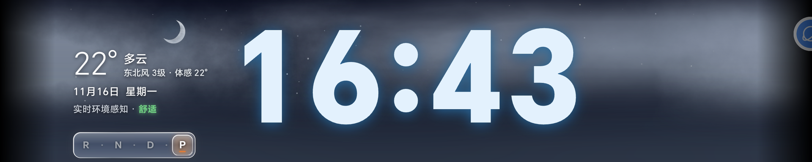 |
| **阴天/雾 (Overcast)** | 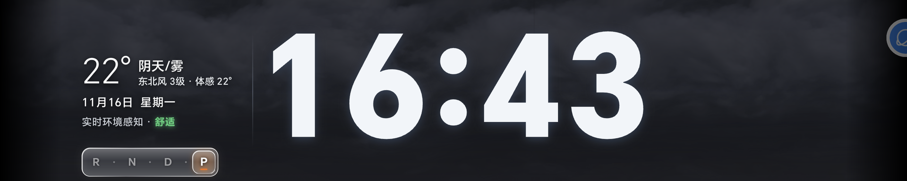 |
| **雨天 (Rain)** | 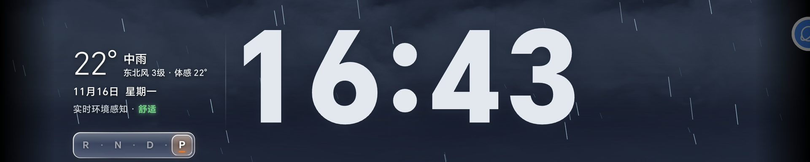 |
| **雪天 (Snow)** | 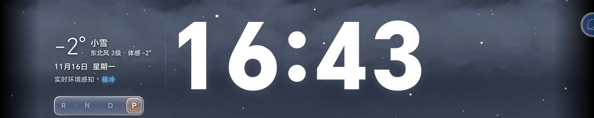 |
| **雷暴 (Storm)** | 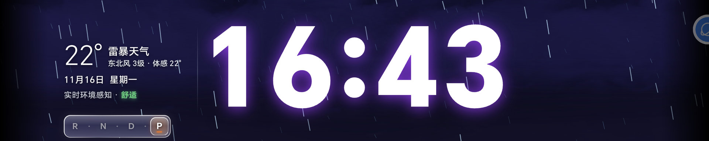 |
| **雨夹雪 (Sleet)** | 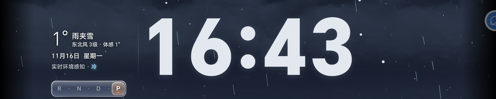 |

---

### 🌅 四、晨曦时段 (Dawn) · 旭日东升与晨光初透

> 日出前后 45 分钟，东方天际初露鱼肚白与玫瑰金粉霞，柔和晨光漫射唤醒清晨驾车体验。

| 气象状态 | 效果截图 |
|---|---|
| **晴朗 (Clear)** |  |
| **多云 (Cloudy)** | 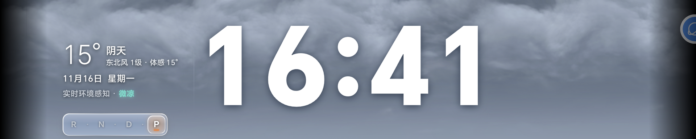 |
| **阴天/雾 (Overcast)** | 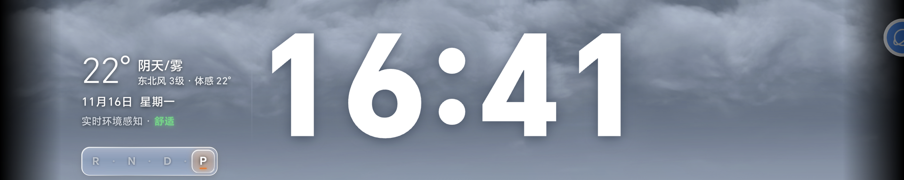 |
| **雨天 (Rain)** | 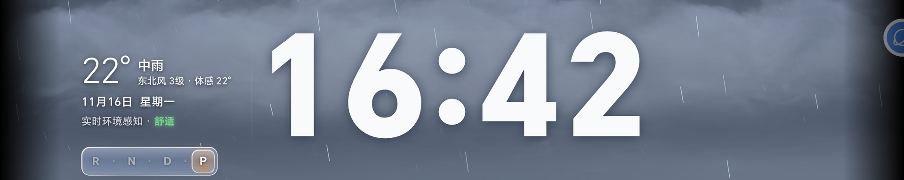 |
| **雪天 (Snow)** | 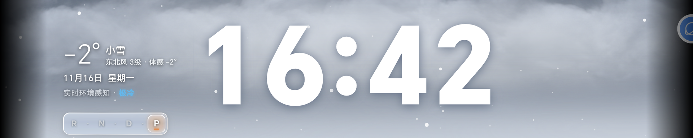 |
| **雷暴 (Storm)** | 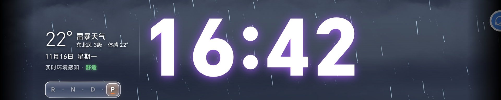 |
| **雨夹雪 (Sleet)** | 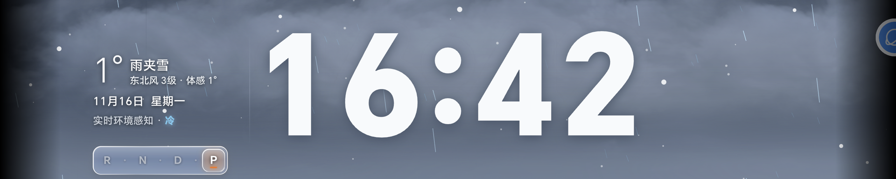 |

---

## 📐 屏幕物理空间分区规范 (1920 × 384)

车机副屏左右两端存在物理弧形装配或边框视野遮挡，标准画布左右各保留 **130px 物理安全黑边 (Vignette)**：

```text
 0px          130px                    700px                    1400px              1790px       1920px
┌──────────────┬────────────────────────┬────────────────────────┬────────────────────┬──────────────┐
│  左侧安全渐变  │    大气数字时钟与日期   │   [中央动态插槽]        │   天体/太阳/月亮    │ 右侧安全渐变  │
│  (Vignette)  │    天气简要徽章         │   车机挡位 (P/R/N/D)   │   雷暴电闪主干区    │ (Vignette)   │
│  0 -> 130px  │    x = 240px           │   驾驶模式 / 电话状态   │   x = 1520px       │ 1790->1920px │
└──────────────┴────────────────────────┴────────────────────────┴────────────────────┴──────────────┘
```

---

## 🛠️ 项目架构概览

```text
XiaoOuScreen/
├── app/
│   ├── src/main/aidl/              # 车机系统中间件通信 AIDL 接口定义
│   ├── src/main/assets/            # 科技感字体与内置歌词源解析脚本
│   ├── src/main/java/
│   │   ├── com/car/xiaoouscreen/   # 小欧屏核心逻辑（时钟、气象、动效、服务、设置）
│   │   └── com/carlyrics/          # 车载歌词引擎（识别、缓存、皮肤渲染、JS插件）
│   └── src/main/res/               # 矢量资源、布局、全尺寸 PNG 图标
├── docs/                           # 说明与 28 种气象时段效果图素材
├── build_and_bump_release.py       # 自动化混淆加固与正式版构建脚本
├── build.gradle.kts                # 根构建脚本
├── settings.gradle.kts             # 项目设置 (XiaoOuScreen)
└── version.properties              # 自动版本计数器
```

---

## 🚀 编译与构建

### 1. 开发环境要求
- **Android Studio**：Hedgehog (2023.1.1) 或更高版本
- **JDK**：OpenJDK 17
- **Android SDK**：Compile SDK 34 / Target SDK 28 / Min SDK 24

### 2. 编译 Debug 版本
```bash
# 克隆仓库
git clone https://github.com/lee1080/XiaoOuScreen.git
cd XiaoOuScreen

# 执行 Debug 构建
./gradlew assembleDebug
```
生成的 APK 位于：`app/build/outputs/apk/debug/`。

### 3. 正式版发行与系统公签
本项目包含车载系统级权限需求（如 `android.permission.CAR_INFO` 等），正式发行版建议配合 AOSP Platform 系统密钥签名：
```bash
# 运行自动化打包脚本（自动执行 R8 深度混淆、资源压缩、版本自增与签名校验）
python3 build_and_bump_release.py
```
> **注意**：正式公签密钥默认配置于 `key/aosp_platform.jks`（受 `.gitignore` 保护不纳入版本控制）。如需系统签名，请将您的车机系统或 AOSP 测试平台密钥放入 `key/` 目录下即可。

---

## 🤝 交流群与赞助支持

如果您喜欢这个项目，或者在使用过程中有任何建议与反馈，欢迎扫码交流或支持作者的持续研发：

<p align="center">
  
  &nbsp;&nbsp;&nbsp;&nbsp;
  
</p>

---

## 📄 开源许可证

本项目遵循 [Apache License 2.0](LICENSE) 开源协议。
